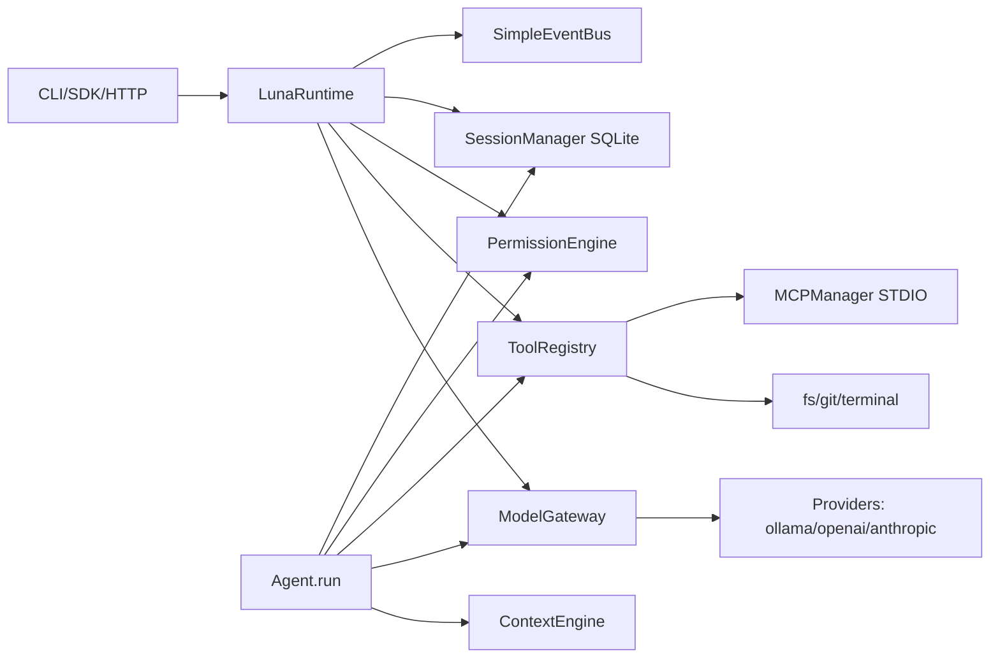

# Luna Runtime


Infraestrutura open source para execução, gerenciamento e orquestração de agentes de IA. Local-first, modular, extensível.

> Princípio central: **o modelo decide, o runtime controla, as ferramentas executam.**

Status atual: **alpha (0.1.0)**, voltada a desenvolvedores. Não é produto pronto para produção.

## 1. Visão Geral

O que é: um runtime que executa agentes de IA com tool-calling, permissões graduais, sessões persistidas em SQLite, integração MCP via STDIO, API HTTP (FastAPI) e SDK Python assíncrono.

Por que existe: manter o controle de execução de ferramentas e permissões no runtime (não no modelo), para que agentes sejam auditáveis, reprodutíveis e seguros em ambientes locais.

Para quem serve:
- Desenvolvedores com LLM local (Ollama) ou endpoints OpenAI-compatible.
- Quem precisa permissões graduais (read..admin) e aprovação humana.
- Quem quer invocar agentes por CLI, SDK assíncrono ou HTTP.
- Pesquisa multi-agent (roles e ondas).

Casos de uso:
- Assistente dev que lê/escreve arquivos, git e terminal.
- Orquestração multi-agent em ondas com paralelismo/cancelamento.
- Integração com servidores MCP via STDIO.
- Backend de agentes via HTTP (FastAPI).
- Benchmarks de latência de execução (MockProvider).

## 2. Princípios e filosofia

- Modelo decide: o LLM produz texto e `tool_calls`.
- Runtime controla: política de permissões, aprovações, limites de iteração, contexto/truncagem, sandbox de terminal (subprocess).
- Ferramentas executam: registry de tools, MCP proxies, built-ins (filesystem/git/terminal).

Não confunda "controle" com "isolamento forte": a sandbox é policy-gating + subprocess (ver Limitações).

## 3. Funcionalidades por camada

| Camada | Módulos | Status |
|---|---|---|
| Foundation | `core/` (config/env), event bus, runtime, CLI | Real |
| Agent Engine | `agents/` (run loop, sessions, context, tool calling) | Real |
| Security | `permissions/` (Engine), allow/deny, aprovações, sandbox terminal | Real parcial |
| Context & Memory | `context/` truncagem por budget; memory in-memory default | Real parcial |
| MCP | `mcp/` STDIO, discovery, proxies | Real |
| Multi-agent | `orchestration/` roles, waves, dependências, cancelamento | Real (planner LLM-driven pendente) |
| API & SDK | `api/` FastAPI, `sdk/` assíncrono | Real baseline |
| Production | pytest, ruff, Docker baseline | Real baseline |

Detalhes:
- Context: `ContextEngine` trunca por budget de tokens (estimativa ~4 chars/token); memória longa primitiva.
- MCP: apenas STDIO; HTTP/SSE pendente.
- API: sem SSE/streaming no runtime LLM (pendente).
- Anthropic provider: stub (não implementado).

## 4. Instalação

Local (dev):
```bash
cd luna-runtime
uv venv
uv pip install -e ".[dev]"
source .venv/bin/activate
```

Docker:
```bash
docker compose up -d --build
curl http://localhost:8000/health
```
Docker usa `LUNA_CONFIG=/data/.luna/config.yaml` e monta `${HOME}/.luna:/data/.luna`.

## 5. Configuração

Path: `~/.luna/config.yaml` (resolução via `LUNA_CONFIG` env se definida). Criado por `luna init`.

Exemplo completo (YAML):
```yaml
runtime:
  name: luna
  environment: local
  debug: false
models:
  default: ollama/qwen3-coder:30b
  providers:
    - name: ollama
      type: ollama
      base_url: http://localhost:11434
    - name: openai
      type: openai
      base_url: https://api.openai.com
      api_key_env: OPENAI_API_KEY
permissions:
  allow_tools: []
  deny_tools: []
memory:
  backend: inmemory
  path: null
execution:
  max_steps: 100
  timeout_seconds: 60
  workdir: null
agents:
  - name: default
    model: default
    role: ""
    system_prompt: ""
    tools: []
    permissions: []
    max_iterations: 10
    context_limit_tokens: 8000
    memory_enabled: true
```

Variáveis de ambiente:
- `LUNA_CONFIG`: caminho alternativo do config.
- `OPENAI_API_KEY` (ou o definido em `api_key_env`/`api_key_env_default`): credenciais de providers OpenAI-compatible.
- `OPENAI_BASE_URL`: fallback de base_url para OpenAI-compatible.

CLI rápida:
```bash
luna init
luna doctor
luna config
```

## 6. Modelos e providers

Referência de modelo: `"provider/model"` (ex.: `ollama/qwen3-coder:30b`). Se não houver `/`, o gateway resolve para o primeiro provider registrado e usa o nome inteiro como model.

Providers no config podem ser strings ou dicts:
- String com `://` → tratado como `{name: str, base_url: str}` (tipo inferido, default openai).
- String sem `://` → `{name: str, type: str}`.
- Dict → campos `name`/`id`, `type`/`kind`/`provider`, `base_url`/`url`, `api_key`, `api_key_env`/`env`.

Inferência de tipo:
- `ollama` se type/name indica ollama ou base_url contém `11434`.
- `anthropic` se name contém anthropic (stub, não disponível).
- Caso contrário `openai` (OpenAI-compatible).

Exemplos:
Ollama:
```yaml
models:
  providers:
    - name: ollama
      type: ollama
      base_url: http://localhost:11434
```

OpenAI-compatible (ex.: Groq/OpenRouter/local):
```yaml
models:
  providers:
    - name: openai
      type: openai
      base_url: https://api.openai.com
      api_key_env: OPENAI_API_KEY
```

Teste de modelo:
```bash
luna model list
luna model test ollama/qwen3-coder:30b
```

## 7. Agentes

Criação via CLI:
```bash
luna agent create nome --model default --system-prompt "..." --tools "fs_read,fs_list"
luna agent list
luna agent inspect nome
```

Persistência: agentes podem ser salvos no config via Web UI (`luna web`) ou editando `~/.luna/config.yaml` (seção `agents`). A API permite criação em runtime (`POST /v1/agents`) mas não persiste no YAML.

Campos (AgentSettings/AgentConfig):
- `name` (obrigatório), `id` (alias, default=name)
- `description`, `role`, `system_prompt`
- `model`, `fallback_model`
- `tools`: lista de tool ids
- `permissions`: lista de níveis (strings ou listas)
- `max_iterations` (default 10)
- `context_limit_tokens` (default 8000)
- `memory_enabled` (default true)

## 8. CLI (comandos principais)

| Comando | Descrição |
|---|---|
| `luna init [--force]` | Cria config padrão em `~/.luna/config.yaml` |
| `luna doctor` | Valida config |
| `luna config` | Imprime config resolvida |
| `luna agent list` | Lista agentes carregados |
| `luna agent create ...` | Cria agente em runtime (não persiste) |
| `luna agent inspect ID` | Inspeciona agente |
| `luna model list` | Lista providers/modelos |
| `luna model test REF` | Health check do provider |
| `luna provider list` | Lista providers |
| `luna provider add NAME URL` | Registra provider em runtime |
| `luna tool list` | Lista tools (registra defaults se vazio) |
| `luna tool inspect ID` | Inspeciona tool |
| `luna session list` | Lista sessões SQLite |
| `luna session inspect ID` | Inspeciona sessão/mensagens |
| `luna run "tarefa" [--agent ID]` | Executa tarefa |
| `luna chat` | REPL simples |
| `luna web [--host] [--port]` | Web UI (Flask, default 5000) |

## 9. API HTTP

FastAPI. Executar:
```bash
uvicorn luna.api.server:app --host 0.0.0.0 --port 8000
```
Endpoints principais:
| Método | Path | Descrição |
|---|---|---|
| GET | `/health` | Health |
| GET | `/v1/models` | Lista modelos por provider |
| GET | `/v1/tools` | Lista tools do registry |
| GET | `/v1/agents` | Lista agentes |
| POST | `/v1/agents` | Cria agente (201) |
| GET | `/v1/agents/{agent_id}` | Inspenciona agente |
| POST | `/v1/agents/{agent_id}/run` | Executa tarefa (body: task, session_id?) |
| GET | `/v1/sessions` | Lista sessões |
| POST | `/v1/sessions` | Cria sessão |
| GET | `/v1/sessions/{session_id}` | Sessão + mensagens |
| GET | `/v1/approvals` | Lista aprovações pendentes |
| POST | `/v1/approvals/{approval_id}/decision` | Decide aprovação (approved/decision) |
| GET | `/v1/metrics` | Métricas in-memory (requests/errors/runs) |

Sem autenticação no baseline (pendente para produção).

## 10. Web UI

Iniciar:
```bash
luna web
# ou
luna web --host 0.0.0.0 --port 8080
```
Acesso: `http://127.0.0.1:5000` (ou host/porta escolhida). Interface de configuração (não chat): runtime, models/providers, execution, memory, agents. Salva no config YAML de forma segura. Também `/health` (service `luna-web`).
Logo servido em `/static/logo.png`.

## 11. SDK

SDK `luna.sdk` é assíncrono. Exemplo completo:
```python
import asyncio
from luna.sdk import LunaRuntime, LunaError

async def main():
    runtime = LunaRuntime()  # ou LunaRuntime(config_path="...")
    await runtime.start()
    try:
        # criar agente
        agent = runtime.create_agent(
            {"name": "Developer", "model": "ollama/qwen3-coder:30b",
             "tools": ["filesystem"], "permissions": ["READ", "WRITE"]},
        )
        # ou usar agent existente do config
        result = await runtime.run("Liste os arquivos do projeto", agent_name="Developer")
        print(result.output)
        print("status:", result.status, "iters:", result.iterations)
        # lista agentes
        for a in runtime.list_agents():
            print(a.config.name, a.config.model)
    except LunaError as e:
        print("erro SDK:", e)
    finally:
        await runtime.shutdown()

asyncio.run(main())
```

Uso com context manager:
```python
async with LunaRuntime() as runtime:
    result = await runtime.run("tarefa", agent_name="default")
    print(result.output)
```

Execução por `agent_name`: `runtime.run(task, agent_name=...)` (default: primeiro agente disponível; se nenhum, cria `default`). Tratamento de erros via `LunaError`.

Alias `LunaClient = LunaRuntime`.

## 12. Sessões e persistência

- `SessionManager` usa SQLAlchemy + aiosqlite.
- Default em runtime: `sqlite+aiosqlite:///:memory:` (sessões não persistem entre processos).
- Para persistir, instancie `SessionManager(db_url="sqlite+aiosqlite:///./luna.db")` e injete no agente/create_agent.
- Operações: init, create_session, get_session, append_message, get_messages, list_sessions.
- Tabelas: `sessions`, `messages` (JSON para tool_calls/tool_result).

Nota: o runtime default não lê path de sessão do YAML (`memory.backend/path` não é usado pelo SessionManager base) — pendente.

## 13. Permissões e segurança

Níveis (`PermissionLevel`): READ, WRITE, EXECUTE, DELETE, NETWORK, ADMIN (valores lowercase: read/write/execute/delete/network/admin).

Modos (`ExecutionMode`):
- `RESTRICTED`: apenas tools explicitamente em allowlist e permissões subset de allowed_permissions.
- `CONTROLLED` (default): ações de alto risco (EXECUTE/DELETE/NETWORK) exigem aprovação humana, salvo tool explicitamente allowlisted com permissões adequadas.
- `TRUSTED`: auto-aprova se allowlist vazio ou tool presente; permissões subset se allowed_permissions não vazio.

Fluxo: agente propõe tool_call → `PermissionEngine.check` → Allow/Deny/PendingApproval → tool executa só após aprovação.

Allow/deny via config `permissions.allow_tools` / `deny_tools`.

Sandbox de terminal (`luna/tools/terminal.py`): subprocess com timeout, cwd restrito ao workdir e blocklist de comandos perigosos. Não é isolamento forte (containers no roadmap). Filesystem/git restritos ao workdir.

Aprovações: `approval_id` gerado; listar/decidir via API `/v1/approvals` (ou programaticamente `engine.resolve`).

## 14. MCP

- Transporte: STDIO apenas (HTTP pendente).
- Config por servidor: `name`, `command`, `args`, `env`, `cwd`, `timeout` (default 30s), `permissions` (default EXECUTE), `enabled`.
- `MCPManager.connect_all()` inicializa processos, descobre tools e registra proxies com id `mcp_<server>_<tool>`.
- Erros por servidor registrados em `MCPManager.errors`.

Uso programático:
```python
from luna.mcp.manager import MCPManager, MCPServerConfig
mgr = MCPManager(tool_registry=runtime.tool_registry)
mgr.add_server(MCPServerConfig(name="fs", command="npx", args=["-y","@modelcontextprotocol/server-filesystem","/tmp"]))
await mgr.connect_all()
```

## 15. Orquestração multi-agent

`Coordinator` (em `luna/orchestration/orchestrator.py`):
- Registro de agentes por role (`register_agent`/`register_agent_factory`).
- Plano de tasks com `id`, `agent_role`, `input`, `depends_on`.
- Execução em ondas (dependências resolvidas), semáforo de paralelismo (`max_parallel_tasks`, default 4).
- Cancelamento cooperativo (`cancel()` cancela tasks em andamento).
- Resultados `TaskResult(id,status,result,error)`.

Planner LLM-driven: pendente.

## 16. Arquitetura

Diagrama:


Módulos:
- `core/`: Settings (YAML/env), Pydantic validation.
- `runtime/core.py`: LunaRuntime agrega providers, agents, registry, permission engine, session manager, gateway, event bus.
- `models/`: ModelGateway + providers (ollama, openai_compat, anthropic stub), schemas request/response.
- `agents/`: Agent cycle (run), AgentConfig/AgentResult.
- `context/`: ContextEngine truncagem.
- `sessions/`: SessionManager SQLite (aiosqlite).
- `tools/`: ToolRegistry, ToolSpec, fs/git/terminal; risco/permissões.
- `permissions/`: PermissionEngine, ExecutionMode.
- `events/`: SimpleEventBus.
- `mcp/`: cliente STDIO + manager; descoberta.
- `orchestration/`: roles/coordinator.
- `api/`: FastAPI factory.
- `sdk/`: cliente async.
- `cli/`: Typer.
- `web/`: Flask config.

Fluxo: entrada → LunaRuntime → Agent.run → gateway → tool_calls validados → AgentResult. Persistência local: SQLite + config em ~/.luna. MCP sob demanda.

## 17. Testes e benchmarks

Testes:
```bash
.venv/bin/pytest -q
```
Configurado em pyproject (`testpaths = ["tests"]`, asyncio auto). Provedores simulados em `tests/fixtures/mock_provider.py`.

Benchmarks:
```bash
python benchmarks/run_simple.py
```
Gera `benchmarks/results.json` (gitignored) com latência p50/p95 etc. usando MockProvider (50 runs + 5 warmup). Números reais dependem do host.

Qualidade:
```bash
.venv/bin/ruff check luna tests
```

## 18. Limitações honestas + roadmap real

Limitações atuais:
- Alpha; APIs podem mudar.
- Sandbox subprocess não é isolamento forte (containers no roadmap).
- Anthropic provider stub.
- MCP apenas STDIO (HTTP pendente).
- Sem SSE/streaming de LLM no runtime.
- Memória longa primitiva.
- Contexto por truncagem.
- Planner LLM-driven (multi-agent) futuro.
- Sem testes de web UI.
- Sessões default in-memory (path de DB não vem do YAML ainda).
- API sem autenticação.
- Agentes criados via API não persistem no YAML.

Roadmap (pendente):
- Provider Anthropic completo.
- MCP HTTP + SSE streaming.
- Isolamento forte (containers).
- Planner multi-agent LLM-driven.
- Persistência de agentes/sessões via config.
- Autenticação na API.

## 19. Troubleshooting

- Config path: verifique `~/.luna/config.yaml` ou `LUNA_CONFIG`. Rode `luna doctor`.
- "provider not registered": confira `models.providers` (string/dict válidos) e `luna provider list`. Ollama exige serviço em `:11434`.
- Ollama model: tags devem existir localmente; `luna model test ollama/<model>`.
- Timeout: `execution.timeout_seconds` e gateway (30s default) afetam; aumente se necessário.
- Testes: rode com `.venv/bin/pytest -q`; config lida de `~/.luna/config.yaml` pode interferir em testes CLI; use env `LUNA_CONFIG` apontando para arquivo temporário.
- Migrations DB: não aplicável (usa SQLAlchemy create_all no init).

## 20. Licença / contato / contribuição

- Licença: MIT (Development Status :: 3 - Alpha).
- Contribuições: ver `CONTRIBUTING.md`. Segurança: ver `SECURITY.md`.
- Issues/PRs bem-vindos. Não commite `.env`/credenciais.

---

Referências rápidas:
- Arquitetura: `docs/architecture.md`
- Permissões: `docs/permissions.md`
- Tools: `docs/tools.md`